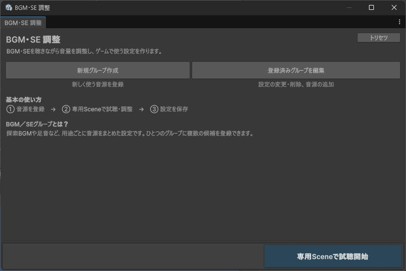
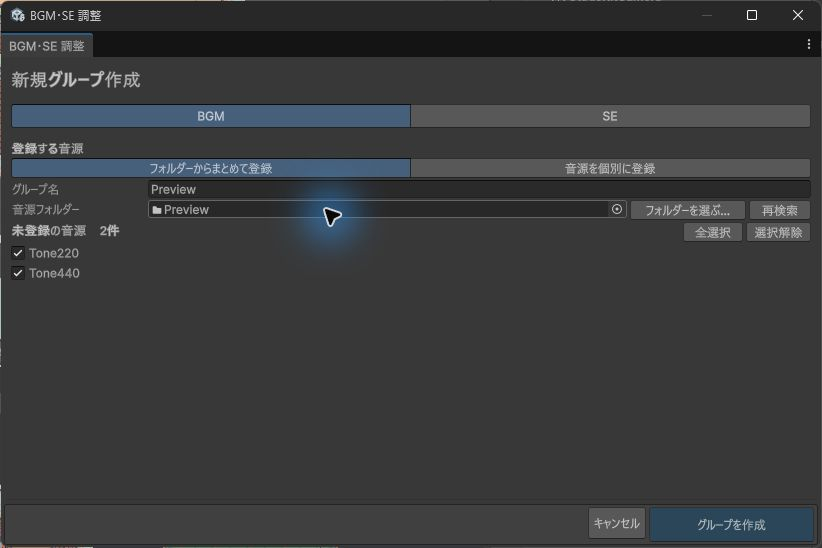
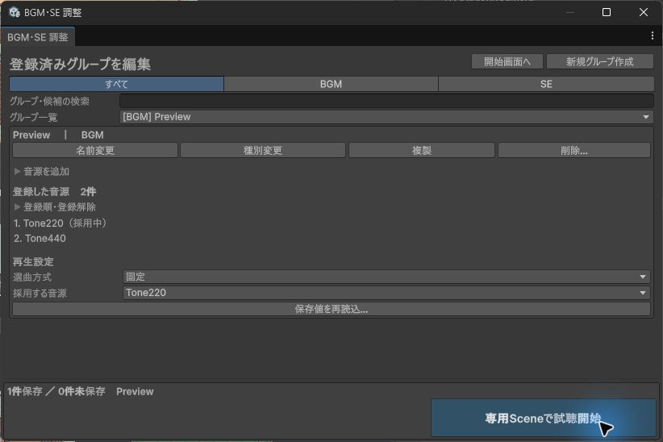
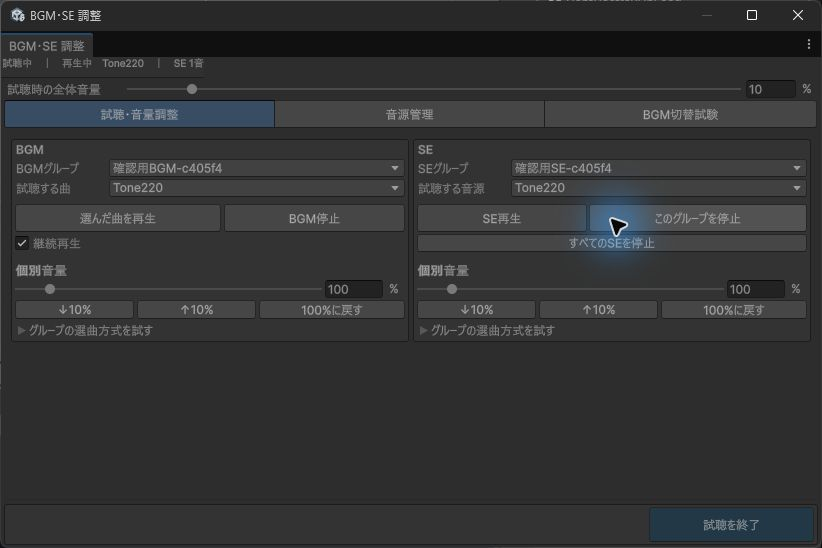
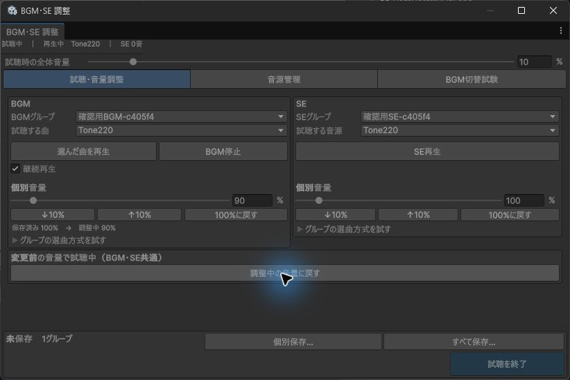
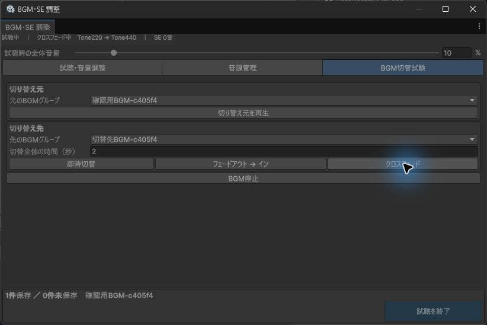
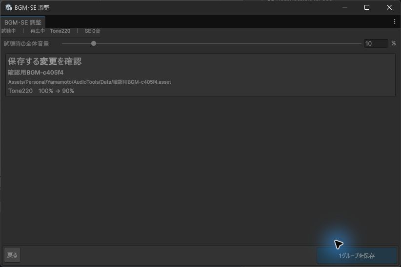
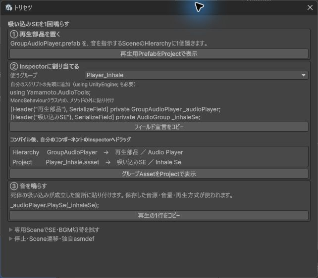

# BGM・SE 調整ツール

Unity の **Tools → Yamamoto → BGM・SE 調整** を開きます。登録済みの音を調整するときは、右下の **専用Sceneで試聴開始** を押します。音源の登録・管理・保存は試聴停止中にもできます。

ゲーム側の担当者は開始画面の **トリセツ** を開いてください。保存済みグループの再生手順をPlay前から確認できます。



## 新しい音源を登録する

1. **新規グループ作成** を押し、BGM／SEと登録方法を選びます。
2. **フォルダーからまとめて登録** ではフォルダーを選ぶかProjectからドロップし、登録する音源にチェックします。フォルダー名がグループ名に入ります。手入力で直した名前は、別のフォルダーを選んでも維持されます。**音源を個別に登録** ではAudioClipを一つずつ追加し、名前を入力します。
3. **グループを作成** を押すと、選んだ音源を含む下書きができ、「登録済みグループを編集」で選択されます。**キャンセル** は作成前の画面へ戻ります。
4. 続けて別のグループを作るか、**専用Sceneで試聴開始** を押します。設定Assetには明示的に保存した時点で記録されます。



## 登録済みの音源を管理する

**登録済みグループを編集** でグループを選びます。グループ名・音源名で検索できます。**音源を追加** でフォルダー・個別のいずれかを選択します。指定済みのフォルダーに素材を追加したときは **再検索** を押してください。

**登録順・登録解除** は登録した音源だけを対象にします。順番方式では並べ替えを直接操作できます。固定方式では採用音源、SEでは同時再生上限と最短間隔も設定できます。



### グループの名前・種類を変える、複製する、削除する

グループを選ぶと、名前のすぐ下に操作が表示されます。

| 操作 | 下書きと保存 |
| --- | --- |
| 名前変更 | 新しい名前を入力し、下書きに反映します。保存すると設定Assetの名前も変わります。Inspectorからの参照は継続します。 |
| 種別変更 | 変更先と参照元を確認します。音源・音量・順序・選曲方式・SE制限は保持します。変更前の種類を期待する呼び出しには注意してください。 |
| 複製 | 未使用の名前を確認して作成します。音源は共用し、音量などの設定は新しい下書きで個別に編集できます。 |
| 削除 | 対象名と参照元を確認して **削除を予約**。**削除予定を取り消す** と元の下書きに戻ります。保存を確定すると設定Assetだけがゴミ箱へ移ります。 |

種別変更と削除には、試聴中のBGM・SEを一度停止してください。確認できた参照元があれば削除は中止します。ツール外から参照されている場合は種別変更も中止します。コード中の文字列や外部データによる利用は検出できません。

[名前変更](RenameGroup.png) ・ [種別変更](ChangeKind.png) ・ [複製](DuplicateGroup.png) ・ [削除](DeleteGroup.png)

## BGMを流しながらSEを調整する

1. **専用Sceneで試聴開始** を押します。開始時には発音しません。
2. BGM欄でグループと曲を選び **BGM再生**。同じ曲を繰り返すときは **継続再生** をオンにして再生します。
3. SE欄でグループと音源を選び **SE再生**。再生制限内で重ねて鳴らせます。
4. 各欄の **個別音量** をスライダーまたは数値欄で指定します。**↓10%／↑10%** は現在値に10ポイントずつ加減します。範囲は0〜1000%、初期値は100%です。
5. 差があるときだけ **変更前の音量で聴く** が現れます。対象はBGMとSEの両方です。**調整中の音量に戻す** か、いずれかの個別音量を再度操作すると調整音に戻ります。BGMは同じ位置から続きます。新規音源には保存済み音量がありません。
6. 下部の **個別保存…／すべて保存…** で差分を確認して保存します。試聴中も再生を続けられます。

上部の **試聴時の全体音量** は初期10%です。試聴中の出力だけを調整します。固定・ランダム・順番の確認には各欄の **グループの選曲方式を試す** を使います。




## BGMの切替を試す

試聴中に **BGM切替試験** を開き、元のグループを再生します。先のグループと時間を選んで **即時切替／フェードアウト → イン／クロスフェード** を押します。時間は切替全体の秒数です。



## 保存と再読込

下部の保存操作で、保存先・音量・登録順などの変更を確認して確定します。対象は `Assets/Personal/Yamamoto/AudioTools/Data/` 内のグループです。一括保存はグループごとに競合・書込可否・不正値・参照を検査します。成功した設定だけが新しい比較基準になります。失敗したグループは理由を表示し下書きを保持します。

**登録済みグループを編集 → 保存値を再読込…** で対象を確認して読み直せます。初回保存前のグループは **この下書きを破棄…** で取り消せます。作成済みの下書きはタブ切替・Play終了・ウィンドウの開閉をまたいで同じUnityセッション内に保持されます。必要な変更はUnity終了前に保存してください。



## ゲームのコードから呼ぶ

### 吸い込みSEを1回鳴らす

1. **トリセツ → 再生用PrefabをProjectで表示** を押し、`GroupAudioPlayer.prefab` を、音を指示するSceneのHierarchyへ1個ドラッグします。Mixerは設定済みです。
2. 自分のスクリプトの先頭に `using UnityEngine;` と `using Yamamoto.AudioTools;` を置きます。**フィールド宣言をコピー** を押し、MonoBehaviourクラス内のメソッドの外に貼り付けます。コンパイル後、Scene上で自分のコンポーネントのInspectorを開き、次の2個を割り当てます。
3. **再生の1行をコピー** を押し、死体の吸い込みが成立した箇所に `_audioPlayer.PlaySe(_inhaleSe);` を貼ります。

| ドラッグ元 | 自分のコンポーネントのInspector |
| --- | --- |
| Hierarchyの `GroupAudioPlayer` | 再生部品の **Audio Player** |
| Projectの `Data/Player_Inhale.asset` | 吸い込みSEの **Inhale Se** |

**グループAssetをProjectで表示** で選んだ設定を探せます。BGMを選ぶと、宣言と呼び出しがBGM用に切り替わります。



**専用SceneでSE・BGM切替を試す** を展開して試聴を開始します。**確認音でSEを1回鳴らす** でサンプルのSEが鳴ります。**探索BGMを再生（220 Hz）** を押し、即時・順次フェード・クロスフェードのいずれかを押すと、追跡音（440 Hz）に変わります。他の方式を試すときは探索BGMから始めます。どれも `Preview/` の保存済みサンプルを使います。

### BGMの切替・停止とScene間の利用

BGMは次のSceneでも続きます。次のSceneから再生・切替を指示するときは、そのSceneに置いた再生部品を使います。Stageを直接Playする場合も、そのSceneにPrefabと有効なAudioListenerを1個ずつ用意し、開始時にBGMを呼びます。独自asmdefでは呼び出し側のAssembly Definition Referencesに `Yamamoto.AudioTools` を追加します。

```csharp
using UnityEngine;
using Yamamoto.AudioTools;

/// <summary>
///     Inspectorで指定した探索BGMと足音を再生する。
/// </summary>
public sealed class StageAudioExample : MonoBehaviour
{
    [Header("音声の参照")]
    [SerializeField] private GroupAudioPlayer _audioPlayer;
    [SerializeField] private AudioGroup _exploreBgm;
    [SerializeField] private AudioGroup _chaseBgm;
    [SerializeField] private AudioGroup _footstepSe;

    /// <summary>
    ///     探索開始時にBGMを継続再生する。
    /// </summary>
    public void StartExploration() => _audioPlayer.PlayBgm(_exploreBgm, loop: true);

    /// <summary>
    ///     足が地面に触れたタイミングで効果音を鳴らす。
    /// </summary>
    public void PlayFootstep() => _audioPlayer.PlaySe(_footstepSe);

    /// <summary>
    ///     追跡に入ったとき、2秒でBGMを重ねて切り替える。
    /// </summary>
    public void StartChase() => _audioPlayer.CrossfadeBgm(_chaseBgm, duration: 2f);
}
```

| API | 動作 |
| --- | --- |
| `PlayBgm(group, loop: true)` | 同じグループの再要求は演奏位置を維持する。単発は `loop: false` |
| `SwitchBgm(group)` | 即時に切り替える |
| `FadeSwitchBgm(group, duration: 2f)` | 1秒で旧曲を消し、次の1秒で新曲を立ち上げる |
| `CrossfadeBgm(group, duration: 2f)` | 2秒間、旧曲と新曲を同時に変化させる |
| `StopBgm()` | 切替待機中・フェード中も含めてBGMを停止する。先頭から再開したいときは停止後に再生する |
| `PlaySe(group)` | グループの制限を満たした要求だけを受理する |
| `StopSe(group)` / `StopSe()` | 指定グループ／全SEを停止する |

再生・切替は受理結果を `bool` で返します。グループ未設定、用途違い、空グループなどでは `false` になります。BGMの2種類のフェードには省略可能な `loop` 引数もあります。曲や基準音量の差し替えはグループを編集して保存し、次回の起動から同じ呼び出しで利用します。

### 選曲・出力の動作

- **固定** は採用音源を使います。**順番** は先頭から始め、末尾の次は先頭です。**ランダム** は有効な候補が複数ある間は直前の候補を外して抽選します。
- BGMの固定継続はSourceでループします。順番・ランダムの継続は曲末で次を選びます。SEは受理した要求だけ選曲を進めます。SEの初期値は同時8音、間隔0秒です。超過した新規要求は無視します。
- Scene側の再生部品は必要な場面で一つの演奏用オブジェクトを作ります。別Sceneの参照口から同じBGMを指定しても演奏は続きます。アクティブSceneの変更でSEとSE選曲履歴を終了します。
- 個別ゲイン・フェード倍率・試聴モニター倍率を掛け合わせて専用Mixerへ送ります。100%は元の信号振幅、1000%は10倍です。スピーカーで感じる大きさは素材と再生環境によって変わります。

本編へ導入する際は、共通Sceneの配置、呼び出し担当、Options・Pauseと出力の関係をチームで確認してください。Web向け公開の場合はブラウザー出力も導入前に検証してください。
